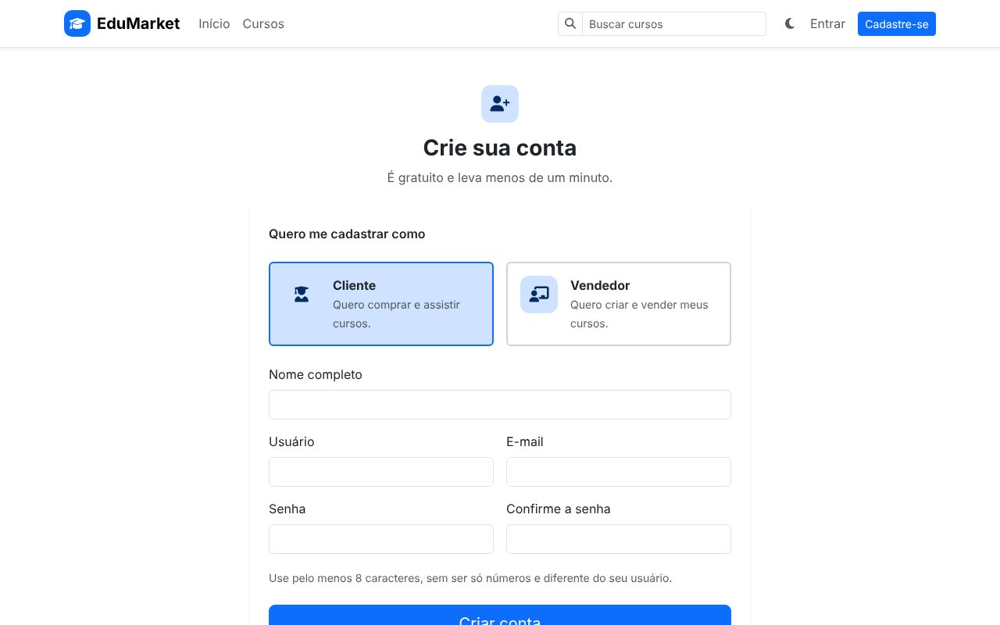
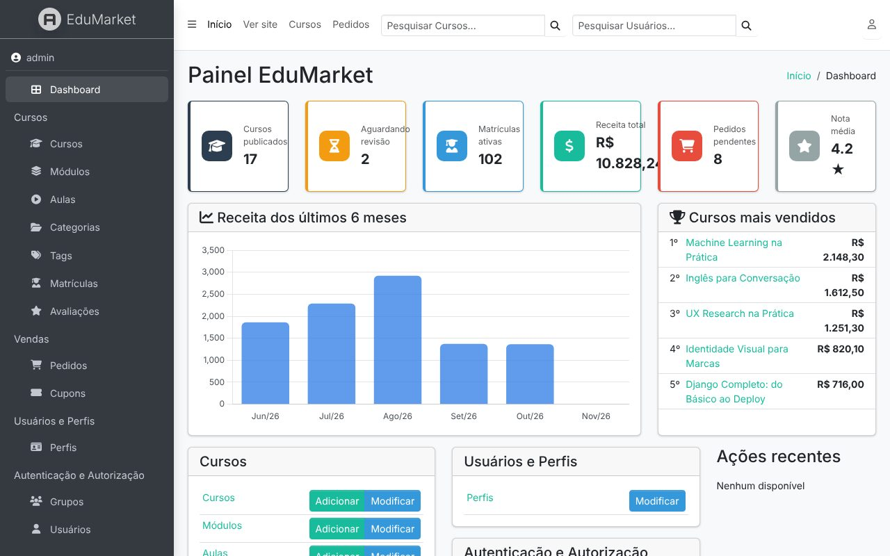
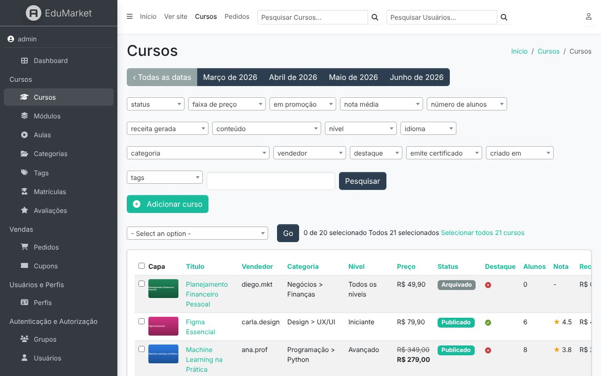
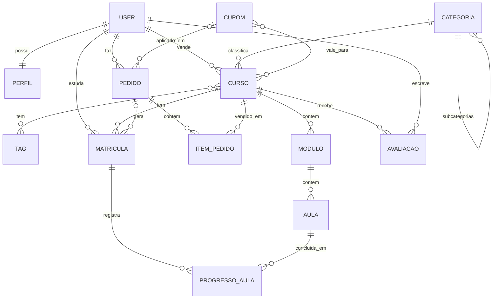

# EduMarket - Marketplace de Cursos Online

**EduMarket** é uma aplicação web para venda de infoprodutos (cursos online), desenvolvida com Django
como projeto da disciplina de Programação Web da Universidade Federal de Lavras (UFLA).

# Alunos

Marco Antonio Roquini Espudario;
Thales Maia Mendonça Negrão

## Descrição do projeto

O EduMarket reúne cursos de diferentes profissionais em um só lugar. Qualquer pessoa pode se cadastrar como:

* **Cliente**: navega pelo catálogo, compra cursos (pagamento simulado via PIX, cartão ou boleto), usa cupons
  de desconto, assiste às aulas, acompanha o progresso e avalia os cursos que comprou.
* **Vendedor**: cria cursos com módulos e aulas, define preços e promoções, cria cupons para os próprios cursos
  e acompanha alunos, avaliações e receita.

A plataforma é gerenciada por um **administrador**, que aprova os cursos enviados pelos vendedores, acompanha
as vendas, modera as avaliações e gerencia usuários pelo ambiente administrativo (Django Admin personalizado
com o tema Jazzmin).

### Telas

| Página inicial (tema claro) | Catálogo (tema escuro) |
|---|---|
|  |  |
| **Detalhes do curso** | **Cadastro** |
|  |  |
| **Admin: painel de indicadores** | **Admin: cursos com filtros** |
|  |  |

<p align="center"><br><em>Layout responsivo no celular</em></p>

## Tecnologias utilizadas

| Camada | Tecnologia | Uso no projeto |
|---|---|---|
| Linguagem | **Python 3.12+** | backend |
| Framework web | **Django 6.1** | models, views, templates, autenticação, admin |
| Banco de dados | **SQLite** | banco relacional (arquivo `code/db.sqlite3`) |
| Ambiente administrativo | **django-jazzmin 3.0** | tema do Django Admin (claro/escuro) |
| Framework CSS | **Bootstrap 5.3** | layout responsivo, componentes e tema claro/escuro do site |
| Ícones | **Font Awesome 6.5** | ícones do site |
| Gráficos | **Chart.js 4.4** | gráfico de receita no painel do admin |
| Imagens | **Pillow** | upload de capas e fotos; geração das capas de exemplo |
| Arquivos estáticos | **WhiteNoise** | entrega dos arquivos CSS/JS |
| Frontend | HTML, CSS e JavaScript | templates do Django; API JSON em `/api/` preparada para um frontend em Vue |

O Bootstrap, o Font Awesome e o Chart.js estão dentro do projeto (`code/static/vendor` e `code/static/js`),
então o site funciona mesmo sem internet.

## Principais funcionalidades

**Para todos os visitantes**
* Página inicial com cursos em destaque, lançamentos e categorias.
* Catálogo com busca, filtros (categoria, nível, preço) e ordenação (recentes, populares, melhor avaliados, preço).
* Página de detalhes do curso: conteúdo por módulos, instrutor, avaliações e resumo das notas.
* Tema claro e escuro (botão na barra de navegação, a escolha fica salva no navegador) e layout responsivo.

**Autenticação**
* Cadastro escolhendo o perfil (cliente ou vendedor), login, logout e edição do próprio perfil (com foto).
* Páginas da área do usuário protegidas por login.

**Cliente**
* Compra de cursos com pagamento simulado e cupons de desconto; cursos gratuitos são liberados na hora.
* "Meus cursos" com o progresso de cada curso e "Meus pedidos" com o histórico de compras.
* Sala de aula com os módulos e aulas do curso; o aluno marca as aulas concluídas e o progresso é atualizado.
* Avaliação dos cursos comprados (1 a 5 estrelas e comentário), com opção de editar ou remover.

**Vendedor**
* Área do vendedor com indicadores (cursos, alunos, receita líquida, nota média) e lista dos próprios cursos.
* Acesso ao ambiente administrativo restrito aos próprios dados: CRUD de cursos, módulos, aulas e cupons;
  consulta de vendas, matrículas e avaliações.
* Envio de cursos para revisão (o administrador é quem publica).

**Administrador**
* Ambiente administrativo completo com painel de indicadores, mais de 20 filtros personalizados,
  ações em massa, exportação para CSV e moderação de avaliações.

## Estrutura do projeto

```
webDevDjango/
├── README.md
├── docs/telas/               # capturas de tela usadas neste README
└── code/
    ├── manage.py             # utilitário de linha de comando do Django
    ├── requirements.txt      # dependências do projeto
    ├── db.sqlite3            # banco de dados com dados de exemplo
    ├── portal_cursos/        # configurações do projeto (settings, urls, mixins do admin)
    ├── usuarios/             # app de usuários: Perfil (cliente/vendedor), login, cadastro, grupos e permissões
    ├── cursos/               # app de cursos: Categoria, Tag, Curso, Módulo, Aula, Matrícula, Progresso, Avaliação
    ├── vendas/               # app de vendas: Cupom, Pedido, ItemPedido + painel de indicadores do admin
    ├── templates/admin/      # personalização do template do admin (painel de indicadores)
    ├── static/
    │   ├── css/              # estilos próprios do site e do admin
    │   ├── js/               # tema claro/escuro e Chart.js
    │   └── vendor/           # Bootstrap e Font Awesome
    ├── media/                # arquivos enviados (capas dos cursos, fotos de perfil)
    └── scripts-bd/           # scripts para popular/limpar o banco
```

Cada app segue a organização padrão do Django:

| Arquivo | Conteúdo |
|---|---|
| `models.py` | tabelas do banco (models) e regras de negócio |
| `views.py` | lógica das páginas |
| `urls.py` | rotas do app |
| `admin.py` / `filters.py` | configuração do ambiente administrativo e filtros personalizados |
| `forms.py` | formulários (perfil, avaliação) |
| `templates/` | páginas HTML (Bootstrap) |
| `tests.py` | testes automatizados |

## Modelagem do banco de dados

| App | Model | Relacionamentos principais |
|---|---|---|
| usuarios | **Perfil** | 1:1 com `User`; tipo CLIENTE ou VENDEDOR |
| cursos | **Categoria** | auto-relacionamento (categoria pai → subcategorias) |
| cursos | **Tag** | N:N com Curso |
| cursos | **Curso** | N:1 vendedor (`User`), N:1 Categoria, N:N Tag |
| cursos | **Modulo** | N:1 Curso |
| cursos | **Aula** | N:1 Módulo |
| cursos | **Matricula** | N:1 aluno (`User`), N:1 Curso, N:1 Pedido — única por aluno+curso |
| cursos | **ProgressoAula** | N:1 Matrícula, N:1 Aula — única por matrícula+aula |
| cursos | **Avaliacao** | N:1 Curso, N:1 aluno — uma por aluno, só para matriculados |
| vendas | **Cupom** | N:1 vendedor (opcional), N:N Curso |
| vendas | **Pedido** | N:1 cliente (`User`), N:1 Cupom |
| vendas | **ItemPedido** | N:1 Pedido, N:1 Curso — guarda o preço do momento da compra |



## Regras de negócio

* Ao criar um usuário, um `Perfil` é criado automaticamente (sinal `post_save`).
* O tipo do perfil define o grupo: **Vendedores** (acessa o admin, com permissões limitadas) ou **Clientes**
  (sem acesso ao admin). Os grupos são criados automaticamente após o `migrate`.
* Curso: slug automático e único; preço promocional deve ser menor que o preço; ao publicar, `publicado_em` é preenchido.
* O vendedor não publica diretamente: envia o curso para **revisão** e o administrador publica. Depois de publicado,
  o vendedor pode editar o curso sem tirá-lo do ar.
* Pedido: totais recalculados a partir dos itens e do cupom; ao **confirmar o pagamento** as matrículas são
  criadas; ao **cancelar/reembolsar** o acesso é removido.
* Cupom: percentual ou valor fixo, com validade e limite de usos. Cupom de vendedor só vale para os cursos dele.
* A plataforma fica com 10% de cada venda (`TAXA_PLATAFORMA` no `settings.py`).
* Avaliações: só alunos com matrícula ativa avaliam (nota de 1 a 5 e comentário opcional), uma por curso.
  Enviar de novo edita a avaliação existente. Ela aparece na hora no site, e o administrador pode
  ocultá-la pelo admin (Cursos → Avaliações).

## Ambiente administrativo

Acesse em `/admin/`. Usa o tema **Jazzmin** (claro/escuro com botão de alternância), com:

* **Painel inicial personalizado** (`templates/admin/index.html`): indicadores, gráfico de receita dos últimos
  6 meses e ranking dos cursos mais vendidos. Para vendedores, mostra apenas os dados dos próprios cursos.
* **Filtros personalizados** (`cursos/filters.py`, `vendas/filters.py`, `usuarios/filters.py`): faixa de preço,
  promoção, nota média, número de alunos, receita gerada, conteúdo do curso, vendedor, duração da aula,
  progresso da matrícula, estrelas, comentário, valor do pedido, uso de cupom, quantidade de cursos,
  situação do cupom (válido/expirado/esgotado/agendado), origem do cupom, tipo de usuário, compras,
  atividade do vendedor, perfil completo — além de filtros por data, relacionamento e `date_hierarchy`.
* **Inlines**: módulos no curso, aulas no módulo, itens no pedido, progresso na matrícula, perfil no usuário,
  subcategorias na categoria.
* **Ações em massa**: publicar, enviar para revisão, arquivar, destacar, duplicar curso, confirmar pagamento,
  cancelar, reembolsar, aprovar avaliações, verificar vendedores, exportar CSV, entre outras.
* **Colunas calculadas**: miniatura da capa, preço com promoção, status colorido, alunos, nota, receita,
  barra de progresso.
* **Permissões por perfil**: vendedores só veem e editam os próprios cursos, módulos, aulas, cupons, matrículas,
  avaliações e vendas (`VendedorRestritoMixin` em `portal_cursos/admin_mixins.py`).

## Instalação

**Pré-requisitos:** Python 3.12 ou superior e Git.

1. Clone o repositório e entre na pasta do código:
   ```bash
   git clone https://github.com/marcoanresp/progWebDjango.git
   cd progWebDjango/code
   ```
2. Crie e ative um ambiente virtual:
   ```bash
   python3 -m venv venv
   source venv/bin/activate          # Linux/macOS
   # venv\Scripts\activate            # Windows
   ```
3. Instale as dependências:
   ```bash
   python3 -m pip install -r requirements.txt
   ```
4. Prepare o banco de dados e os arquivos estáticos:
   ```bash
   python3 manage.py migrate
   python3 manage.py collectstatic --noinput
   ```
5. (Opcional) O repositório já traz um banco com dados de exemplo. Para recriá-lo do zero:
   ```bash
   rm db.sqlite3
   python3 manage.py migrate
   python3 scripts-bd/popula_bd.py
   ```
   Para criar só um administrador próprio, use `python3 manage.py createsuperuser`.

## Execução

Com o ambiente virtual ativo, dentro da pasta `code`:

```bash
python3 manage.py runserver
```

* Site: <http://127.0.0.1:8000/>
* Ambiente administrativo: <http://127.0.0.1:8000/admin/>

Usuários de exemplo (senha `edumarket123` para todos):

| Usuário | Perfil |
|---|---|
| `admin` | administrador (superusuário) |
| `ana.prof`, `bruno.dev`, `carla.design`, `diego.mkt`, `elisa.lang` | vendedores |
| `cliente01` … `cliente30` | clientes |

Cupons para testar: `BEMVINDO10` (10% em qualquer curso), `PYTHON30` (R$ 30 nos cursos da `ana.prof`)
e `DJANGO20` (20% no curso de Django).

Para executar os testes automatizados:

```bash
python3 manage.py test
```

Para recriar os grupos e permissões dos perfis: `python3 manage.py configurar_perfis`.

## Rotas

| Rota | Descrição | Acesso |
|---|---|---|
| `/` | página inicial | público |
| `/cursos/` | catálogo com busca e filtros (`?q=&categoria=&nivel=&preco=&ordem=`) | público |
| `/cursos/<slug>/` | detalhes do curso | público |
| `/cursos/<slug>/avaliar/` | cria ou edita a avaliação do aluno (POST) | aluno matriculado |
| `/cursos/<slug>/avaliar/excluir/` | remove a avaliação do aluno (POST) | aluno matriculado |
| `/comprar/<slug>/` | cria o pedido (POST) | logado |
| `/pedidos/`, `/pedidos/<id>/` | pedidos do cliente, cupom e pagamento simulado | logado |
| `/meus-cursos/`, `/meus-cursos/<slug>/` | área do aluno | logado |
| `/meus-cursos/<slug>/aulas/<id>/concluir/` | marca ou desmarca a aula como concluída (POST) | aluno matriculado |
| `/vendedor/` | área do vendedor | vendedor |
| `/auth/login`, `/auth/cadastro`, `/auth/logout`, `/auth/perfil` | autenticação e perfil | — |
| `/api/cursos/`, `/api/cursos/<slug>/`, `/api/categorias/` | API JSON para o Vue | público |
| `/admin/` | ambiente administrativo | administrador e vendedores |
