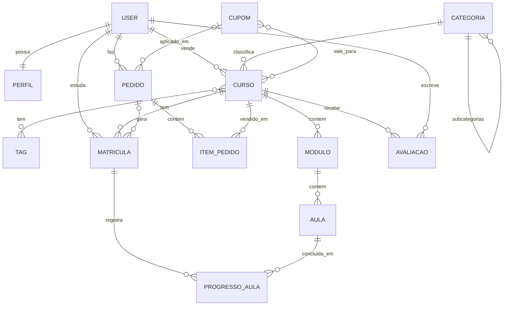

# EduMarket - Marketplace de Cursos Online

Aplicação web em Django para venda de infoprodutos (cursos online). Qualquer pessoa pode se cadastrar como
**cliente** (compra e assiste cursos) ou **vendedor** (cria e vende cursos). A plataforma é gerenciada por um
**administrador** pelo ambiente administrativo (Django Admin com tema Jazzmin).

> Etapa 1: estrutura principal e backend (modelagem, admin, permissões, regras de negócio e API JSON).
> O frontend definitivo será feito em Vue consumindo a API em `/api/`.

## Estrutura do projeto

```
code/
├── portal_cursos/        # configurações do projeto (settings, urls, mixins do admin)
├── usuarios/             # app de usuários: Perfil (cliente/vendedor), login, cadastro, grupos e permissões
├── cursos/               # app de cursos: Categoria, Tag, Curso, Módulo, Aula, Matrícula, Progresso, Avaliação
├── vendas/               # app de vendas: Cupom, Pedido, ItemPedido + painel do admin
├── templates/admin/      # personalização do template do admin (painel de indicadores)
├── static/               # CSS/JS do site e do admin
├── scripts-bd/           # scripts para popular/limpar o banco
└── requirements.txt
```

## Modelagem do banco de dados

| App | Model | Relacionamentos principais |
|---|---|---|
| usuarios | **Perfil** | 1:1 com `User`; tipo CLIENTE ou VENDEDOR |
| cursos | **Categoria** | auto-relacionamento (categoria pai → subcategorias) |
| cursos | **Tag** | N:N com Curso |
| cursos | **Curso** | N:1 vendedor (`User`), N:1 Categoria, N:N Tag |
| cursos | **Modulo** | N:1 Curso |
| cursos | **Aula** | N:1 Módulo |
| cursos | **Matricula** | N:1 aluno (`User`), N:1 Curso, N:1 Pedido — única por aluno+curso |
| cursos | **ProgressoAula** | N:1 Matrícula, N:1 Aula — única por matrícula+aula |
| cursos | **Avaliacao** | N:1 Curso, N:1 aluno — uma por aluno, só para matriculados |
| vendas | **Cupom** | N:1 vendedor (opcional), N:N Curso |
| vendas | **Pedido** | N:1 cliente (`User`), N:1 Cupom |
| vendas | **ItemPedido** | N:1 Pedido, N:1 Curso — guarda o preço do momento da compra |



### Regras de negócio

* Ao criar um usuário, um `Perfil` é criado automaticamente (sinal `post_save`).
* O tipo do perfil define o grupo: **Vendedores** (acessa o admin, com permissões limitadas) ou **Clientes**
  (sem acesso ao admin). Os grupos são criados automaticamente após o `migrate`.
* Curso: slug automático e único; preço promocional deve ser menor que o preço; ao publicar, `publicado_em` é preenchido.
* O vendedor não publica diretamente: envia o curso para **revisão** e o administrador publica.
* Pedido: totais recalculados a partir dos itens e do cupom; ao **confirmar o pagamento** as matrículas são
  criadas; ao **cancelar/reembolsar** o acesso é removido.
* Cupom: percentual ou valor fixo, com validade e limite de usos. Cupom de vendedor só vale para os cursos dele.
* A plataforma fica com 10% de cada venda (`TAXA_PLATAFORMA` no `settings.py`).

## Ambiente administrativo

Tema **Jazzmin** (claro/escuro com botão de alternância), com:

* **Painel inicial personalizado** (`templates/admin/index.html`): indicadores, gráfico de receita dos últimos
  6 meses e ranking dos cursos mais vendidos. Para vendedores, mostra apenas os dados dos próprios cursos.
* **Filtros personalizados** (`cursos/filters.py`, `vendas/filters.py`, `usuarios/filters.py`): faixa de preço,
  promoção, nota média, número de alunos, receita gerada, conteúdo do curso, vendedor, duração da aula,
  progresso da matrícula, estrelas, comentário, valor do pedido, uso de cupom, quantidade de cursos,
  situação do cupom (válido/expirado/esgotado/agendado), origem do cupom, tipo de usuário, compras,
  atividade do vendedor, perfil completo — além de filtros por data, relacionamento e `date_hierarchy`.
* **Inlines**: módulos no curso, aulas no módulo, itens no pedido, progresso na matrícula, perfil no usuário,
  subcategorias na categoria.
* **Ações em massa**: publicar, enviar para revisão, arquivar, destacar, duplicar curso, confirmar pagamento,
  cancelar, reembolsar, aprovar avaliações, verificar vendedores, exportar CSV, entre outras.
* **Colunas calculadas**: miniatura da capa, preço com promoção, status colorido, alunos, nota, receita,
  barra de progresso.
* **Permissões por perfil**: vendedores só veem e editam os próprios cursos, módulos, aulas, cupons, matrículas,
  avaliações e vendas (`VendedorRestritoMixin` em `portal_cursos/admin_mixins.py`).

## Como executar

```bash
cd code
python3 -m venv venv
source venv/bin/activate
python3 -m pip install -r requirements.txt
python3 manage.py migrate
python3 manage.py collectstatic
python3 scripts-bd/popula_bd.py      # dados de exemplo (opcional)
python3 manage.py runserver
```

* Site: <http://127.0.0.1:8000/>
* Admin: <http://127.0.0.1:8000/admin/>

Usuários criados pelo script (senha `edumarket123`):

| Usuário | Perfil |
|---|---|
| `admin` | administrador (superusuário) |
| `ana.prof`, `bruno.dev`, `carla.design`, `diego.mkt`, `elisa.lang` | vendedores |
| `cliente01` … `cliente30` | clientes |

Para recriar os grupos/permissões manualmente: `python3 manage.py configurar_perfis`.

## Rotas

| Rota | Descrição | Acesso |
|---|---|---|
| `/` | página inicial | público |
| `/cursos/` | catálogo com busca e filtros (`?q=&categoria=&nivel=&preco=&ordem=`) | público |
| `/cursos/<slug>/` | detalhes do curso | público |
| `/comprar/<slug>/` | cria o pedido (POST) | logado |
| `/pedidos/`, `/pedidos/<id>/` | pedidos do cliente, cupom e pagamento simulado | logado |
| `/meus-cursos/`, `/meus-cursos/<slug>/` | área do aluno | logado |
| `/vendedor/` | área do vendedor | vendedor |
| `/auth/login`, `/auth/cadastro`, `/auth/logout`, `/auth/perfil` | autenticação e perfil | — |
| `/api/cursos/`, `/api/cursos/<slug>/`, `/api/categorias/` | API JSON para o Vue | público |
| `/admin/` | ambiente administrativo | administrador e vendedores |

## Testes

```bash
python3 manage.py test
```
